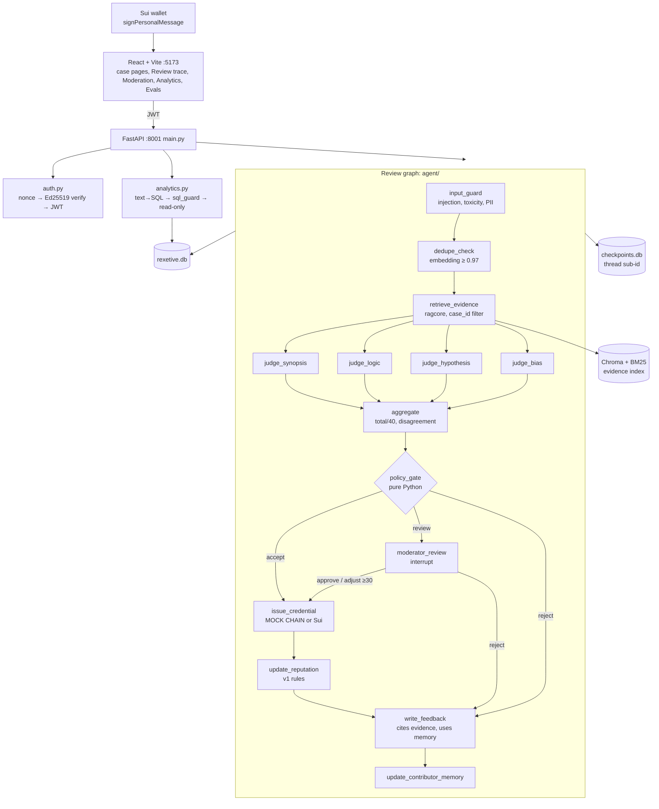

# Rexetive v2 architecture: concept → file → why

| Concept | File | Why it's built this way |
|---|---|---|
| Shared retrieval core | `backend/ragcore/` | Copied from BridgeBot (see `ragcore/SHARED.md`). Hybrid BM25 + dense, RRF, cross-encoder, guards, SQL guard, tracing, metrics. |
| Evidence packs + rubric | `backend/data/cases/<id>/`, `cases.py` | Fictional cases (no real people or crimes). Stable evidence ids (E1..E7) in front matter, so citations survive re-chunking. `case.json` holds the rubric for offline judges and is never sent to the frontend. |
| Evidence retrieval | `cases.py::retrieve_evidence` | Hybrid + rerank restricted by `where={"case_id": n}`, deduplicated to one entry per document. |
| Input guard | `agent/nodes.py::input_guard` | Runs before any model: PII is masked, injection is flagged (forces human review), toxic content makes the submission unsafe (reject). |
| Near-duplicate check | `agent/nodes.py::dedupe_check` | bge embeddings vs the case's existing submissions. The threshold of 0.97 was measured: distinct analyses reach 0.94, copies are ≥ 0.998. |
| Four judges, in parallel | `agent/judges.py`, `agent/graph.py` | Narrow prompts, one schema each, temperature 0. Fan-out from `retrieve_evidence` and fan-in at `aggregate`; a merge reducer lets parallel nodes write `judges[name]`. |
| Data wrapping | `agent/judges.py::SYSTEM` | Evidence and submission are tagged as data, and the prompt says instructions inside them are ignored. This is defence in depth on top of the guard. |
| Offline judges | `agent/judges.py::offline_judge` | Deterministic rubric scoring (key facts, traps, solution keywords, bias markers), so the whole system runs without a key. |
| Policy gate | `agent/policy.py` | The decision is code: readable, testable, auditable. The models only provide evidence-cited scores. |
| Human-in-the-loop | `agent/nodes.py::moderator_review` | `interrupt()` plus the SQLite checkpointer: the run pauses with its full state and resumes from the queue, even after a restart. |
| Side effects after the gate | `chain.py`, `issue_credential`, `update_reputation` | The only writes with external meaning, reachable only via accept. `SUI_MOCK=1` returns fake digests logged as "MOCK CHAIN"; v1's `blockchain_utils.py` is imported only when real. |
| Feedback + contributor memory | `write_feedback`, `update_contributor_memory`, `db.py` | Long-term memory about a contributor (recurring weak dimensions) makes feedback specific over time. |
| Moderation log → evals | `db.py::log_moderation`, `evals/generate_evals.py` | Every human decision is stored next to the AI's original verdict, and overrides become new labelled cases. |
| Auth | `auth.py`, `frontend/src/contexts/AuthContext.jsx` | Wallet signature (Sui personal-message intent, blake2b digest, Ed25519) → JWT. Roles: `contributor` and `moderator`. The demo bypass exists only with `DEMO_MODE=true`. |
| Safe text-to-SQL | `analytics.py`, `ragcore/sql_guard.py` | The guard makes the *database* safe; showing the SQL makes the *answer* checkable. Typed SQL goes through the same guard. |
| Evals | `evals/` | Calibration, red team, trajectories and retrieval all run in sandbox DBs, and `run_all` writes `data/logs/eval_report.md`. |
| API | `main.py` | v1 endpoints keep their paths and shapes (now agent-backed), and new endpoints are added. Field mapping: clarity=synopsis, consistency=logic, plausibility=hypothesis, relevance=bias (objectivity). |

## Checkpointer vs contributor memory vs moderation log

- **Checkpointer** (`data/checkpoints.db`): the execution state of one review run (thread `sub-<id>`). It exists so a run can pause at `interrupt()` and resume.
- **Contributor memory** (`contributor_memory` table): facts about a *person* across many runs, used to personalise feedback.
- **Moderation log** (`moderation_log` table): an audit trail of human decisions, and the source of new eval cases.
