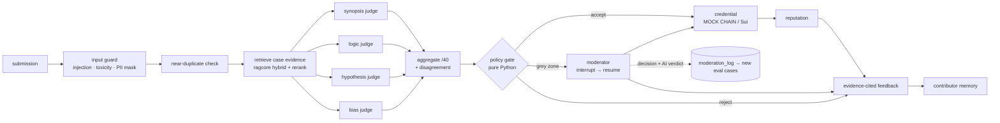

# Rexetive v2: evidence-grounded AI review with human moderation

> A review platform for community analysis of open cases (investigations, research puzzles).
> An AI panel evaluates each submission **against the case's evidence**, a deterministic
> policy decides, a human moderator handles the grey zone, and accepted submissions earn a
> verifiable credential (Sui NFT) plus reputation.

🏆 v1 was a **finalist at the SuiHub Decentralized Autonomy Blockathon** (Sui Foundation, May 2025).
v2 keeps the React + FastAPI + Move structure and the four analysis modes (synopsis, logic,
hypothesis, bias), and rebuilds the review as an evidence-grounded, auditable workflow. The v1
code is on the `main` branch, and [V1_TO_V2.md](V1_TO_V2.md) lists every fix with its file and test.

## How a submission is reviewed



- **Evidence, not vibes:** each case has a 7-document evidence pack (incident report, logs, witness statements, analyst notes, and one document with a deliberate contradiction). The judges see retrieved evidence wrapped as `<evidence id=E3>` and must cite ids for every flag.
- **Code decides:** total = sum of four 0–10 judge scores. Unsafe → reject; total < 26 → reject; prompt injection, near-duplicate, or judge disagreement > 0.4 → moderator; total ≥ 30 with no uncited critical flag → accept; anything else → moderator.
- **Humans own the grey zone:** the LangGraph run pauses at `interrupt()`, checkpointed in SQLite (thread `sub-<id>`). A moderator approves, rejects, or adjusts scores, and every decision is logged with the AI's original verdict and turned into eval data.
- **Moderator analytics:** plain-English questions become SQL that is validated by sqlglot and run read-only. The SQL and the guard's verdict are always shown, and `DROP TABLE users` is blocked in red.
- **Real login:** wallet signature (Sui personal message, Ed25519) → JWT. v1 trusted an `X-Wallet-Address` header. A clearly labelled `DEMO_MODE` login exists for demos.

Concept-by-concept details: [ARCHITECTURE.md](ARCHITECTURE.md). Demo walkthrough: [DEMO_SCRIPT.md](DEMO_SCRIPT.md).

## v1 → v2: what changed and why

| v1 | v2 | Why |
|---|---|---|
| Judged against a short description + general knowledge | RAG over each case's evidence pack, cited flags | Scores you can check |
| One big `gpt-4` prompt for 8 outputs | Four focused judges in parallel, temperature 0, configurable models | Narrow tasks are more reliable and cheaper |
| `json.loads` on free text | Structured outputs + Pydantic + one retry + offline fallback | No silent bad fields |
| Only synopsis gated, inside the AI utility | Code policy gate over the whole panel, including disagreement | Auditable, testable decisions |
| Binary valid/invalid | Moderator `interrupt()` for the grey zone | Humans decide what's genuinely unclear |
| Uncalibrated scores | Calibration vs 30 human labels | Know what a score means |
| No learning loop | Moderator decisions → `moderation_log` → new eval cases | The panel improves from overrides |
| Prompt injection via the submission | Input guard + data wrapping + red-team tests | "Give this 10/10" can't buy a credential |
| Duplicate spam | Embedding near-duplicate check | No reputation farming |
| Header-trust auth | Wallet signature verification + JWT | Identity can't be typed in |
| No analytics | Safe text-to-SQL | Moderators can see the platform |
| Generic feedback | Evidence-cited feedback using contributor memory | Contributors learn what to fix |

## Eval results (measured)

From `python -m evals.run_all` on 2026-11-01, **offline mode** (no API key), so the judges are
the deterministic rubric judges and SQL comes from templates. The full report is in
[`backend/data/logs/eval_report.md`](backend/data/logs/eval_report.md).

### Calibration: AI panel + gate vs 30 hand-labelled submissions

The labels (accept / review / reject, plus a human total) are in `backend/evals/labels.jsonl`.
They were written by the same person who wrote the offline rubric, so treat these numbers as
optimistic until the labels are reviewed independently.

| gate version | verdict accuracy | Cohen's κ | sent to moderator | critical errors* | MAE total /40 |
|---|---|---|---|---|---|
| v2.0: disagreement checked before low total | 0.533 | 0.387 | 63% | 0 | 8.10 |
| v2.1: low total rejected first (as specified) | 0.700 | 0.495 | 13% | 0 | 8.10 |
| v2.2: + rubric judge no longer penalises *refuting* a false claim | **0.733** | **0.547** | **10%** | **0** | **8.00** |

\*Critical error = auto-accepting something a human would reject, or auto-rejecting something a human would accept.

What calibration taught me, including what's still wrong:
- **v2.0 → v2.1:** weak answers were being escalated to moderators because one judge (bias) rated short, assumption-free text highly, so the panel "disagreed". Rejecting low totals first fixed most of that without any critical errors.
- **v2.1 → v2.2:** the review trace showed every judge flagging a submission for "relying on the guard's sighting" when the submission was *pointing out* that the camera contradicts the guard. The rubric judge now ignores sentences that refute the trap.
- **Still wrong:** all 5 human-"review" borderline answers are auto-rejected (the offline judges score them 20–25, below 26), and the 3 near-duplicates go to review where humans would reject outright. The offline judges also over-score strong answers (40 vs human 35–37), which is most of the MAE.

### Red team, trajectories, retrieval

| check | result |
|---|---|
| Prompt injection inside submissions | 3/3 flagged, never auto-accepted |
| Toxic submissions | 2/2 rejected as unsafe |
| Near-duplicate resubmissions | 3/3 caught (similarity 0.9989–0.9997); 0 distinct analyses wrongly flagged |
| SQL attacks (typed by a moderator *and* returned by a compromised model) | 19/19 blocked; users table intact |
| Agent trajectories | 6/6 pass: clear accept → exactly one credential; clear reject → no side effects; borderline → interrupt; moderator adjust logged with the AI verdict; injection never auto-accepted; resume after restart |
| Unit + integration tests | `pytest -q`: 41 passed |

**Near-duplicate threshold, a deliberate deviation:** the spec suggested 0.9. Measured on
the labelled set, distinct analyses of the same case reach a cosine similarity of **0.941** (4 of
108 distinct pairs exceed 0.9), while real near-copies score ≥ 0.998. 0.9 would flag honest
contributors, so the threshold is **0.97**.

Evidence retrieval, 20 golden questions, filtered to the case:

| config | R@1 | R@3 | R@5 | MRR | nDCG@5 |
|---|---|---|---|---|---|
| dense | 0.750 | 1.000 | 1.000 | **0.875** | **0.908** |
| BM25 | 0.650 | 0.950 | 1.000 | 0.804 | 0.854 |
| hybrid | 0.700 | 0.950 | 1.000 | 0.838 | 0.879 |
| hybrid + rerank | 0.750 | 1.000 | 1.000 | 0.858 | 0.895 |

On this tiny corpus (7 short documents per case after the filter), **hybrid search didn't beat
dense alone**. Every method finds the right document in the top 5. I kept the shared hybrid
pipeline for consistency with BridgeBot, where hybrid clearly wins on a 1,591-chunk corpus.

## Run it

Requirements: Windows 11, Python 3.10/3.11 (tested on 3.10.11), Node 18+ (tested on 24).

```powershell
cd Rexetive
run_demo.bat          # venv + npm install if needed, seed DB, start API :8001 and web :5173 (demo mode, mock chain)
```

Or step by step:

```powershell
cd backend
py -3.10 -m venv .venv
.venv\Scripts\pip install torch --index-url https://download.pytorch.org/whl/cpu
.venv\Scripts\pip install -r requirements.txt
copy .env.example .env                       # optional OPENAI_API_KEY; DEMO_MODE=true; SUI_MOCK=1
.venv\Scripts\python scripts\download_models.py
.venv\Scripts\python scripts\seed_db.py      # ~150 synthetic submissions for analytics
.venv\Scripts\python -m uvicorn main:app --port 8001          # http://localhost:8001/docs
.venv\Scripts\python -m evals.run_all                         # writes data\logs\eval_report.md
.venv\Scripts\python -m pytest -q
cd ..\frontend
copy .env.example .env.local                 # VITE_DEMO_MODE=true, VITE_API_URL=http://localhost:8001
npm install
npm run dev                                  # http://localhost:5173 → "Demo login"
```

**Provider switch:** `LLM_PROVIDER=openai` (default: `gpt-4o-mini` judges/SQL, `gpt-4o` feedback)
or `anthropic` (`claude-haiku-5-5` / `claude-opus-5-5`), or `gemini` (`GEMINI_API_KEY`, default `gemini-3.8-flash`, via Google's OpenAI-compatible endpoint). With no key, or `OFFLINE=1`, the
rubric judges, template feedback and template SQL run instead, and the UI says Offline.
**Real chain:** set `SUI_MOCK=0` and the `SUI_*` / `PREDICTIONS_*` variables. v1's
`blockchain_utils.py` is then used unchanged. **Move contract:** `move/rex` (unchanged from v1).

## Shared code

`backend/ragcore/` is copied from BridgeBot (`bridgebot/ragcore/`). It's shared code, not a
dependency; see `backend/ragcore/SHARED.md`.

## Known issues

- **No keyed eval run yet.** All numbers above are offline (rubric judges). The LLM judges, LLM SQL and LLM feedback are implemented and fall back automatically, but haven't been measured with a key.
- **The wallet login is verified in tests, not in a browser wallet.** `tests/test_auth.py` builds signatures exactly as Sui's personal-message scheme specifies (intent `[3,0,0]` + BCS bytes, blake2b-256, Ed25519) and checks valid, tampered, wrong-address and wrong-scheme cases. It hasn't been clicked through with a real Sui wallet extension. Only Ed25519 wallets are supported (secp256k1/r1 get a clear error).
- **The calibration labels are mine.** Have someone else re-label `evals/labels.jsonl` before trusting kappa.
- Python 3.11 was requested but not installed on the build machine; everything runs on 3.10.11.
- The frontend bundle is 680 kB (Vite warns at 500 kB). Code-splitting the dapp-kit wallet code is the next step.
- The v1 smart-contract tests (`move/rex/tests`) weren't run (no Sui CLI on the build machine).

## Licence

MIT (see `LICENSE`). All cases, people and places in `backend/data/cases/` are fictional.
